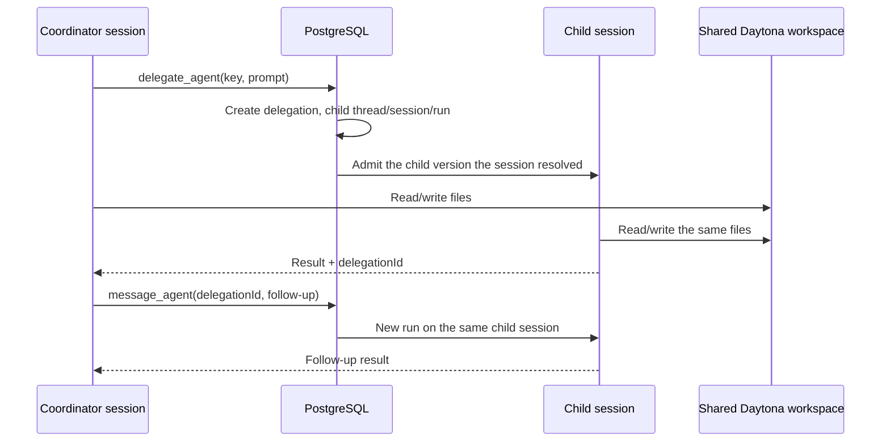

OAO coordinators can delegate work to named, versioned child agents. Each child
gets its own durable session and Flue instance, while every thread in the
delegation is bound to the coordinator's workspace. This gives the child access
to files created by the coordinator without mixing their conversation histories.

## Publish the roster first

A coordinator can call only delegates frozen into its immutable agent version.
Each delegate either **pins** an exact child version or **follows** a child
agent's latest published version:

```json
{
  "systemPrompt": "Coordinate shipment analysis and review extracted facts.",
  "modelPreset": "coordinator-v1",
  "tools": [],
  "skillVersionIds": ["44444444-4444-4444-8444-444444444445"],
  "skillIds": ["55555555-5555-4555-8555-555555555555"],
  "delegates": [
    {
      "key": "invoice-review",
      "description": "Check invoice totals against the extracted facts.",
      "agentVersionId": "22222222-2222-4222-8222-222222222222"
    },
    {
      "key": "shipment-extraction",
      "description": "Extract shipment facts into the shared workspace.",
      "agentId": "33333333-3333-4333-8333-333333333333",
      "maxParallel": 2
    }
  ],
  "sandbox": {
    "enabled": true,
    "provider": "daytona-primary",
    "snapshotId": "77777777-7777-4777-8777-777777777777",
    "network": "none",
    "capabilities": ["filesystem_read", "filesystem_write", "shell"]
  },
  "limits": { "maxTurns": 32, "timeoutMs": 300000 }
}
```

This coordinator pins version `22222222-…` of the invoice reviewer and follows
the shipment-extraction agent `33333333-…`. It also pins one Skill version in
`skillVersionIds` and follows Skill `55555555-…` in `skillIds`; see
[Versioned Skills](/concepts/skills#pin-or-follow-a-skill).

| Delegate field   | Meaning                                                                                                   |
| ---------------- | --------------------------------------------------------------------------------------------------------- |
| `agentVersionId` | Pins that exact immutable child version. A pinned delegate never changes.                                 |
| `agentId`        | Follows that agent. Each new session uses its latest published version, resolved when the session starts. |

A delegate names exactly one of the two. Delegate keys must be unique, and so
must the pinned versions and the followed agents. A coordinator can contain at
most 32 delegates, and `maxParallel` is from 1 through 8. Publishing rejects a
child from the coordinator's own agent definition. The platform tool names
`delegate_agent` and `message_agent` are reserved.

Because the workspace is shared, coordinator and child versions must select
the same sandbox enabled state, provider key, snapshot, and network policy.
Their capability arrays may differ, so a child can receive a narrower set of
filesystem, shell, or browser tools. Publication also rejects direct or
indirect delegate cycles.

The console exposes the same roster under **Agents → Delegates**. Each pick pins
the agent's current version; switch a linked delegate's version selector to
**Latest version** to follow the agent instead. A later child publication never
changes an existing coordinator version; it only changes what a following
delegate resolves to in new sessions. Child agents with an incompatible sandbox
identity remain visible but disabled, with the mismatched enabled state,
provider, snapshot, or network policy explained beside them.

## Versions are resolved when a session starts

A coordinator version stays immutable when it follows a delegate. The version
a followed delegate runs is decided per session:

- When a root session is created, OAO resolves "latest" once for the root agent
  version and for every delegate it can reach, including nested delegates and
  their Skills. It reads them all from one consistent database snapshot.
- The result is frozen for the whole session tree. Delegated child sessions
  copy the root session's resolution, so a child published while the session
  runs never mixes versions inside one tree.
- Follow-up runs in the session, and later turns sent to its child sessions,
  keep the same versions. Start a new session to pick up newer versions.

"Latest" means the agent's most recent published version. A deleted agent, or
one without a published version, cannot be followed.

The session-create response and `GET /sessions/{sessionId}` return the record
as `resolvedVersions`. It lists every agent version in the tree, root first,
with the exact Skill and delegate versions each one runs. `followsLatest` tells
you which links were resolved from a followed agent or Skill:

```json
{
  "resolvedVersions": {
    "schemaVersion": 1,
    "rootSessionId": "7fd65b84-30ea-4ca9-aa40-ac219698e718",
    "rootAgentVersionId": "11111111-1111-4111-8111-111111111111",
    "resolvedAt": "2026-11-03T09:00:00.000Z",
    "agentVersions": [
      {
        "agentId": "10000000-0000-4000-8000-000000000001",
        "agentVersionId": "11111111-1111-4111-8111-111111111111",
        "version": 4,
        "skills": [
          {
            "skillId": "50000000-0000-4000-8000-000000000001",
            "skillVersionId": "44444444-4444-4444-8444-444444444445",
            "version": 2,
            "name": "carrier-codes",
            "followsLatest": false
          },
          {
            "skillId": "55555555-5555-4555-8555-555555555555",
            "skillVersionId": "66666666-6666-4666-8666-666666666666",
            "version": 5,
            "name": "shipment-intake",
            "followsLatest": true
          }
        ],
        "delegates": [
          {
            "key": "invoice-review",
            "agentId": "20000000-0000-4000-8000-000000000002",
            "agentVersionId": "22222222-2222-4222-8222-222222222222",
            "version": 2,
            "followsLatest": false
          },
          {
            "key": "shipment-extraction",
            "agentId": "33333333-3333-4333-8333-333333333333",
            "agentVersionId": "88888888-8888-4888-8888-888888888888",
            "version": 7,
            "followsLatest": true
          }
        ]
      },
      {
        "agentId": "20000000-0000-4000-8000-000000000002",
        "agentVersionId": "22222222-2222-4222-8222-222222222222",
        "version": 2,
        "skills": [],
        "delegates": []
      },
      {
        "agentId": "33333333-3333-4333-8333-333333333333",
        "agentVersionId": "88888888-8888-4888-8888-888888888888",
        "version": 7,
        "skills": [],
        "delegates": []
      }
    ]
  }
}
```

`resolvedVersions` is `null` for sessions created before OAO recorded
resolutions; those sessions run their agent version's pinned links, which is
all such a version can have. The console session view shows the same resolved
versions.

## Safety checks

Publishing a coordinator returns `400 bad_request` when a followed delegate:

- is not a live agent of the same project, or has no published version;
- is the coordinator's own agent;
- has a latest version whose sandbox enabled state, provider, snapshot, or
  network policy differs from the coordinator's; or
- would close a cycle. OAO walks followed agents through their latest
  versions, and a link anywhere in the tree that follows the coordinator's own
  agent counts as a cycle.

Publications with delegates are serialized per project, so two concurrent
publications cannot each close half of a cycle.

A later publication can still change what a followed link resolves to, so OAO
checks the tree again when a session starts. Session creation returns
`409 conflict`, creates nothing, and names the agent, version, and link when:

- a followed agent was deleted or has no published version;
- a followed agent's latest version now uses a different sandbox than its
  coordinator;
- a followed Skill was deleted, is disabled, has no published version, or has
  a deprecated or revoked latest version;
- two Skills bound to one agent version would share a name; or
- the delegates form a cycle.

For example:

```json
{
  "error": {
    "code": "conflict",
    "message": "Agent \"Shipment coordinator\" version 4: delegate shipment-extraction follows agent \"Shipment extraction\", whose latest version 8 uses a different sandbox enabled state, provider, snapshot, or network policy than the coordinator. Publish a compatible coordinator version, or pin a compatible version of the delegate.",
    "requestId": "..."
  }
}
```

Sessions that already started are not affected: they keep the versions they
resolved.

## Change the sandbox of a followed agent

OAO does not refuse to publish a child version that is incompatible with the
coordinators that follow it. Instead, new sessions of those coordinators fail
with the `409` above until a compatible coordinator version is published or the
delegate is pinned.

Refusing the child's publication would deadlock chain-wide changes. Rolling a
new sandbox snapshot through coordinator → child → grandchild changes every
agent in the chain. Whichever agent you publish first is briefly mismatched
with a neighbor, so every publication order would be refused. Failing at
session start lets the bottom-up order work, leaves running sessions
untouched, and names the fix.

To roll a sandbox change through agents that follow each other:

1. Publish the deepest followed agent with the new sandbox.
2. Publish each coordinator above it with the same sandbox, from the bottom up.
   Each publication is checked against the version you published in the step
   before.
3. Until a coordinator is republished, new sessions that reach its changed
   delegate fail clearly with `409`.

If those sessions must keep working during the rollout, pin first: from the
bottom up, publish coordinator versions whose delegates pin exact versions
instead of following them. Roll the sandbox change, then publish coordinator
versions that follow again.

## Runtime flow



OAO, not Flue's ephemeral subagent helper, owns the durable relationship. The
runtime uses a separate registered `ManagedAgent` instance for each child
thread. PostgreSQL stores the coordinator-child relation, exact versions,
workspace binding, run sequence, idempotency hashes, and cancellation state.

The coordinator uses:

- `delegate_agent({ agent, prompt })` to create a persistent child thread;
- the returned `delegationId` to correlate later work; and
- `message_agent({ delegationId, prompt })` to create another run in that same
  child session after its previous run settles.

Different child versions can therefore carry different prompts, model presets,
Skills, tools, approvals, sandbox capability policies, and limits. The child is
still constrained by the shared sandbox's provider and network boundary; its
Flue conversation and transcript remain isolated.

## Durability and safety

- PostgreSQL is authoritative. Deterministic request keys make tool replay
  return the existing delegation or child run instead of duplicating work.
- Before a platform tool claim, the runtime idempotently provisions its
  tenant-scoped service principal. Internal broker or database failures become
  a generic platform-tool failure instead of exposing database details to the
  model or transcript.
- The platform tool claim behind `delegate_agent` and `message_agent` holds a
  bounded lease that the runtime renews on a heartbeat for as long as the child
  runs, so a delegation that takes minutes still returns the child's response
  in one attempt. If another worker takes the claim over, the superseded
  executor aborts its wait and stands down without submitting a result.
- Child threads use the normal fenced admission, wake recovery, product-run
  deadline, and Flue retry paths.
- Cancelling or timing out a parent run cascades cancellation to its unsettled
  children. Operators can also cancel a delegation directly.
- Parallel calls are allowed up to the published `maxParallel` value. Each call
  has a separate child thread but shares the workspace.
- Raw delegation prompts are stored only as authorized child transcript/run
  input. Tool ledgers, product events, audit records, logs, and traces receive
  IDs and bounded metadata such as character counts, never the prompt text.
- RLS repeats organization and project identity across every orchestration
  relation. API reads and mutations require the delegation scopes documented in
  [HTTP API](/reference/http-api).

## Operator follow-up

`GET /sessions/{sessionId}` includes `delegations`. The console renders links to
the persistent child sessions. The Sessions table also places every visible
child immediately beneath its coordinator with an indented tree connector;
the child uses a compact row treatment, and both rows remain direct links to
their own isolated transcripts. Filtered or
paginated results never hide an otherwise visible child merely because its
parent is outside the current result set.

An operator can submit a later child turn with
`POST /delegations/{delegationId}/messages`, using a fresh idempotency key, or
cancel the relation with `POST /delegations/{delegationId}/cancel`.

<Warning>
  The MVP does not dynamically discover arbitrary agents, change a roster on a
  published version, upgrade a running session to a newer delegate version, move
  a child to a different workspace, or merge child conversation history into the
  coordinator. Human approval belongs to the normal durable tool/approval flow;
  only after settlement should the coordinator or operator send a follow-up to
  the same child.
</Warning>
